# GitHub App PR workflow

The GitHub adapter verifies and persists PR deliveries, dispatches durable work,
and publishes a commit-bound GitHub Check. `application.ChangeWorkflow` composes
the existing Intent, SIR, ChangeGraph, ProofPlanner, verifier registry and policy
engine. Local callers invoke `Run`; hosted callers invoke `RunHosted`. Both use
the same implementation and verifier registry. Hosted work additionally requires
sandbox isolation. There is no edition-specific verifier or Stripe lookup.

```mermaid
flowchart LR
 W[Signed webhook] --> T[Tenant binding]
 T --> E[Entitlement and permission]
 E --> Q[PostgreSQL outbox / JetStream]
 Q --> C[ChangeID]
 C --> I[Intent]
 I --> S[SIR]
 S --> G[ChangeGraph]
 G --> P[ProofPlan]
 P --> V[Shared verifier registry]
 V --> R[Policy]
 R --> D[Trust decision]
 D --> A[Immutable artifacts]
 A --> K[GitHub Check]
```

## Authority and identity

Only a valid signature permits parsing/admission. The adapter follows GitHub's
[HMAC-SHA256 webhook validation](https://docs.github.com/en/webhooks/using-webhooks/validating-webhook-deliveries).
Bodies are capped at 1 MiB and duplicate JSON keys are rejected. Supported PR
actions are opened, reopened, synchronize, ready_for_review and edited; unrelated
validly signed events are explicitly ignored.

Installation ID and numeric repository ID resolve through the existing
organization GitHub binding. A separately provisioned `github_pr_bindings` record
selects a current organization member as automation actor and pins a canonical
policy hash. The webhook sender never supplies a principal, role, subscription,
policy, credential or tenant ID. Both `verify.basic` and `proof.execute` are
required. The hosted PR workflow additionally requires the existing
`verify.pr_enforcement` and `proof.cloud_history` capabilities. Private
repositories also require `integration.github.private`. Owning private GitHub
integration alone does not imply PR enforcement. Local core invocation does not
acquire these hosted capabilities and retains its existing local admission rules.
Current membership, repository ownership and entitlements are checked at ingress,
worker execution and Check publication. Each planned verifier also uses the
configured shared execution guard and quota admission.

ChangeID is SHA-256 over a version tag, organization ID, repository ID, immutable
base SHA and immutable head SHA. PR job identity additionally includes the
installation, numeric repository, PR number and policy hash. Edition and product
version do not enter source identity. A changed policy creates a distinct job
on a subsequent PR delivery; the worker rejects a factory returning another
policy hash. Existing jobs and evidence are not rewritten on plan changes.

## Shared core

`ChangeWorkflowConfig` injects the current execution guard, a trusted bounded
`ChangeSource`, SIR normalizer, ProofPlanner, existing verifier `Registry`, runner,
immutable artifact store and sealed policy. `ChangeSource.Prepare` is responsible
for safely materializing both immutable revisions and extracting bounded facts.
It must never interpret repository content as policy or authorization. Intent
is captured with `NewIntentContract`, not trusted as a statement of correctness.
Incomplete SIR coverage remains incomplete. ChangeGraph file and semantic entity
nodes preserve source pins and SIR provenance; causal edges are not invented.

The planner's target and provider/budget configuration are trusted server inputs.
A `VerifierIDs` map lets distinct planner providers (for example `go-build` and
`go-test`) select capabilities from the same registered `go` verifier. No duplicate
SDK or altered normalization logic is required.
A missing provider, unavailable proof level, incomplete SIR, scanner error,
missing evidence, policy error or UNKNOWN cannot yield PASS. Achieved proof level
is derived only from passing observations for every required planned step.
Confidence and determinism are explicit trusted assessment configuration.
`ChangeArchive` reuses `evidence.OriginalStore` and verifies returned hash/length;
the existing local archive implements this contract, as must a private S3 adapter.
Large artifacts stay out of PostgreSQL.

The core returns a diagnostic PASS/FAIL/UNKNOWN. It never authorizes a deployment.
The API does not expose a route for callers, scanners, prompts or MCP output to
submit a passing result. The full artifact bundle is persisted before a passing
Check can be emitted. GitHub receives a fixed summary and ChangeID, not scanner
output, repository content or credentials.

## Durability and Checks

Migration `000012_github_pull_requests.up.sql` adds automation bindings, PR jobs
and immutable delivery receipts to the existing schema. Receipt insertion and
job creation share a transaction. A delivery ID reused with another payload hash
or job is rejected. Different deliveries for the same immutable PR/policy job
reuse that job. Admission serializes per organization and bounds unfinished work
to 100 jobs and new delivery receipts to 1000 per hour.

The outbox publishes organization/work IDs to `safepatch.tenant.<organization_id>.github_pr`.
Workers validate the subject against the envelope and scope job reads and updates
by organization. See [tenant-boundary rollout](tenant-boundaries.md). It waits for a durable
JetStream acknowledgement and retries failed publication. Workers reload the
stored actor and request instead of trusting message attributes. An eight-minute
execution deadline and ten-minute fenced lease prevent late workers replacing
newer results. Outbox recovery republishes unfinished jobs after ten minutes.
Provision the stream deduplication interval below that interval, a durable pull
consumer with explicit acknowledgements, bounded delivery/pending limits, and
AckWait greater than ten minutes. Isolate subjects with broker ACLs.

Verification commits a READY result before Check delivery. Check publication is
a separate transaction with a row lock; a GitHub outage retries publication
without rerunning verification. Completed results are immutable. The client uses
an RSA-signed App JWT and requests [repository-scoped installation tokens](https://docs.github.com/en/enterprise-cloud%40latest/apps/creating-github-apps/authenticating-with-a-github-app/authenticating-as-a-github-app-installation).
Tokens stay in the adapter process and never enter the queue or runner.

The client re-reads PR base/head and repository visibility before reporting.
Stale/closed PR observations produce a cancelled Check. PASS with durable evidence
maps to success; FAIL maps to failure; UNKNOWN or missing evidence maps to
action_required. Checks bind the immutable head SHA and a stable external ID.
Retries search for the exact App/external ID/head tuple before creating a Check,
then update its ID. GitHub does not offer a transaction with SafePatch's database:
an ambiguous network failure can still require reconciliation or produce a
duplicate remote Check. A Check is not an atomic merge authorization; use
appropriate GitHub up-to-date branch/merge policy for concurrent base changes.
See GitHub's [Check Run API](https://docs.github.com/en/rest/checks/runs).

## Configure the App and ingress

Register one GitHub App with repository metadata/contents/pull_requests read
permissions and checks write permission. Subscribe to pull_request events and set
the webhook URL to `<public-origin>/v1/integrations/github/webhook`. Configure a
cryptographically random webhook secret of at least 32 bytes. No real secrets
are committed. Signature key rotation is supported by `NewWebhook` accepting two
secrets; the API environment composition currently accepts one active secret.

Apply migrations 000001 through 000012 once using the
[shared migration procedure](../../migrations/README.md). Complete the existing
[GitHub installation/repository onboarding](onboarding.md), then provision the
automation actor and policy hash using a trusted operator transaction. The actor
must be an active member permitted to execute proofs. This milestone does not
create an elevated service account or automatically grant an owner role.

Add these values to the existing `safepatch-api serve` server environment:

| Variable | Meaning |
| --- | --- |
| `SAFEPATCH_GITHUB_WEBHOOK_SECRET` | Active webhook signature secret; enables the route |
| `SAFEPATCH_GITHUB_PR_STREAM` | Pre-provisioned JetStream stream for PR jobs |

Existing PostgreSQL, NATS, public-origin and onboarding configuration remains
required by that composition root. Route GitHub directly to the Go API; do not
send the webhook through the Next.js onboarding proxy. The single OpenAPI
specification documents ingress and its response codes. HTTP 202 means durable
admission, not completed verification.

## Worker composition and current limits

Construct `githubapp.NewClient` with the numeric App ID, an RSA private key from
your secret manager (PKCS#1 or PKCS#8, at least 2048 bits), clock and optional trusted
test transport. Production calls use only `https://api.github.com`; redirects and
environment-controlled proxies are disabled. No clone URL or callback URL from a
webhook is followed. Use the same configured `Store` and `PullRequestAdmission`
with `NewWorker`, then call `Consume(ctx, natsConnection, stream, durable)`.

`CoreFor` must resolve the pinned tenant policy hash and construct the shared
`application.ChangeWorkflow`. Supply an admitted source/extraction adapter,
the existing container runner, current quota services and private immutable
storage. `NewWorker` accepts that concrete workflow, not a parallel GitHub engine.
For local invocation, use the same workflow with local tenant/entitlement adapters
and the existing local archive. Local trusted execution remains an explicit
execution setting; hosted PRs cannot select it.

The worker orchestration, App authentication, Check transport and core composition
are implemented and tested. **A production source-fetch/extractor factory and
authenticated S3 transport are not supplied, and the command-shell
worker is not automatically started.** Those infrastructure boundaries were also
absent before this change. A deployment must provide them to execute real PRs;
the API alone durably queues work. The subsequent [tenant-boundary milestone](tenant-boundaries.md)
adds a scope-bound S3 evidence adapter over a trusted transport port.
No substitute PASS or fake source extractor
is installed. Live GitHub/PostgreSQL/NATS/S3/container interoperability remains
unverified here. Native migration tests require the existing opt-in database setup.

Initial limitations: SHA-1-format Git commit IDs only; no installation lifecycle
provisioning, check_run rerequest UI or merge-queue events; automation currently
uses an explicitly configured organization user because the existing SQL
membership model has no service-account table. Policy updates require a new PR
delivery for a new job. Receipt archival/retention is an operator responsibility;
completed receipts are append-only. Graph snapshots are archived with the proof;
this milestone does not add graph query APIs or infer causal edges from text.

## Validation and file inventory

Tests cover signed/tampered/oversized/poisoned webhooks, private entitlement and
independent permission boundaries, cross-installation/repository rejection,
downgrade preservation, RSA JWT signatures and scoped tokens, stale heads,
UNKNOWN/no-evidence Checks, duplicate Check reuse, atomic receipts, Check retry
without verification rerun, and current-permission checks. An integration test
runs the same existing Go verifier through local and hosted core entrypoints and
compares the resulting Intent/SIR/Graph/Plan/evidence/policy artifacts exactly.
Process execution and GitHub transport are fixtures in that test; it is not a
live sandbox deployment. Native SQL fixtures test retained subscriptions, tenant
FKs, receipt idempotency and immutable result/state transitions.

Validation on 2026-09-07: `go test ./...`, `go test -race ./...`, and
`go vet ./...` passed, including the repository architecture checks. The migration
contract test passed; native PostgreSQL execution reported the expected opt-in
skip. No live GitHub Check, sandbox worker or cloud artifact was created.

Inspected: onboarding GitHub/session/store/host code; organization and billing
runtime; authorization/tenant/execution guard; Intent/SIR/ChangeGraph/ProofPlanner,
verifier lifecycle and Go adapter; policy/evidence archive; migration harness;
OpenAPI and architecture tests.

Created: `internal/domain/change.go`, `internal/trust/decision.go`,
`internal/application/change_workflow.go`, `change_archive.go`,
`pull_request.go`, `pull_request_test.go`; `internal/platform/githubapp/`;
`internal/platform/billingstore/github_pr_test.go`; migration 000012,
`internal/platform/migrationtest/github_pr{_test.go,_before.sql,.sql}`; this document.

Modified: `internal/platform/onboardinghost/server.go`, root README, migration
README, and the existing OpenAPI specification/README. No frontend, edition,
subscription, entitlement key, prior migration or module dependency changes.
